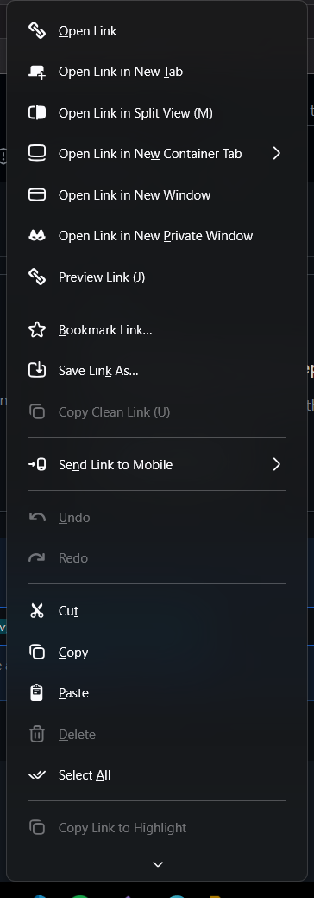

# Better Firefox Context Menu

A `userChrome.css` that gives Firefox's menus icons, roomier rows, a rounded hover highlight and a wider layout. It covers the page, tab, bookmark and toolbar right-click menus, the menu bar (File, Edit, History, ...) and the downloads and extension menus. Built for Firefox 159 on Windows.



## Install

In PowerShell:

```powershell
irm https://raw.githubusercontent.com/TimurCravtov/BetterFirefoxContextMenu/main/install.ps1 | iex
```

Then fully quit and reopen Firefox.

It installs into the profile each Firefox install actually uses (release, Nightly, ...), backs up any existing `userChrome.css` to `userChrome.css.bak`, and sets `toolkit.legacyUserProfileCustomizations.stylesheets` in `user.js`.

### Options

Piped scripts can't take parameters, so use a script block:

```powershell
$i = [scriptblock]::Create((irm https://raw.githubusercontent.com/TimurCravtov/BetterFirefoxContextMenu/main/install.ps1))
& $i -List                          # list profiles
& $i -ProfileName <folder-name>     # install into a specific profile
& $i -Uninstall                     # remove it (restores your backup)
```

Or clone the repo and run `.\install.ps1` with the same flags.

## Notes

Every rule uses `!important`: `userChrome.css` is a user-level sheet and Firefox's own menu styles would otherwise override it. Icons are Firefox's built-in `chrome://` icons, so they follow your theme.
